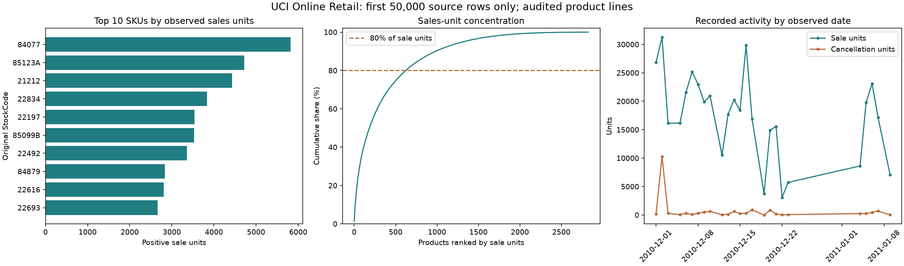

# Retail Demand & Cancellations Dashboard

An interactive retail analytics application that audits a bounded transaction prefix, separates positive sales from cancellation records, reconciles signed monetary values and measures product-unit concentration.

> Data boundary: results use the first 50,000 original workbook rows, not a representative full year. Cancellation records are not matched purchases or verified physical returns.

## Contents

- [Overview](#overview)
- [Dataset and data contract](#dataset-and-data-contract)
- [Architecture and components](#architecture-and-components)
- [Processing pipeline](#processing-pipeline)
- [Configuration and metric definitions](#configuration-and-metric-definitions)
- [Recorded results and evidence](#recorded-results-and-evidence)
- [Interpretation and operational use](#interpretation-and-operational-use)
- [Running locally](#running-locally)
- [Validation and reproducibility](#validation-and-reproducibility)
- [Project structure](#project-structure)
- [Technology stack](#technology-stack)
- [Limitations and next steps](#limitations-and-next-steps)
- [Further technical documentation](#further-technical-documentation)

## Overview

Which products drive **observed sales units and cancellation records**, and how concentrated is the recorded activity?

## Dataset and data contract

[UCI Online Retail](https://archive.ics.uci.edu/dataset/352/online+retail), a public UK online retailer dataset, licensed [CC BY 4.0](https://creativecommons.org/licenses/by/4.0/). Citation: Chen, D. (2015). Online Retail [Dataset]. UCI Machine Learning Repository. [DOI: 10.24432/C5BW33](https://doi.org/10.24432/C5BW33).

The original has **541,909 transaction lines**. This project uses only the **first 50,000 data rows in original workbook order**, bundled as a small compressed CSV for offline use. They span **1 December 2010, 08:26 to 9 January 2011, 15:13**. This deterministic teaching prefix is not a random or annual representative sample. The final day is partial; an extra source-row check confirms the cutoff falls between invoices 540541 and 540542.

| Column | Meaning and treatment |
|---|---|
| source_row | Added row number, 1–50,000, for tracing exclusions |
| InvoiceNo | Transaction identifier; C prefix identifies a cancellation record |
| StockCode | Original product/item code; grouping key, preserving case |
| Description | Display label; first available description per filtered SKU |
| Quantity | Signed units per line; direction must agree with invoice marker |
| InvoiceDate | Source transaction timestamp; inclusive calendar-date filtering |
| UnitPrice | Price per unit in GBP, converted exactly to integer pennies |
| CustomerID | Public source identifier; missing IDs are retained, not imputed |
| Country | Customer country in source; dashboard filter |

See [source provenance](data/SOURCE.md) and [checksums](data/manifest.json). The original XLSX/ZIP is not committed. `prepare_data.py` can optionally recreate the exact subset from the free, no-login UCI archive. Normal dashboard runs need no download.

## Architecture and components


| Component | Entry points or assets | Responsibility |
|---|---|---|
| [prepare_data.py](prepare_data.py) | Source preparation | Reproduce the bounded public-workbook prefix and its checksum manifest. |
| [main.py](main.py) | load_data / prepare | Verify source order and assign one mutually exclusive audit status per row. |
| [main.py](main.py) | filter_rows / analyze | Apply country/date filters, aggregate signed transaction values and calculate concentration. |
| [main.py](main.py) | recommendations / export / save_chart | Produce investigation priorities and auditable static evidence. |
| [app.py](app.py) | Streamlit interface | Expose synchronized KPIs, ranking controls, plots, quality context and filtered downloads. |
| [test_dashboard.py](test_dashboard.py) | Automated checks | Verify signed-money arithmetic, denominators, Pareto boundaries, filters and empty/cancellation-only views. |

## Processing pipeline

1. Verify the compressed source's decompressed checksum and its sequential 50,000 source-row IDs. Audit actual missingness rather than assuming the catalogue summary covers every field.
2. Assign each line one status, using the first matching reason: later exact repeat of the eight source fields, invalid required field, non-product-format code, nonpositive/invalid price, inconsistent quantity direction, or included. Suspect repeats are quarantined conservatively; they may be legitimate repeated lines. Preserve all raw records.
3. Use a disclosed **product-format proxy**: five digits followed by zero to two letters. This excludes postage/manual/fee/voucher and other nonstandard codes, but is not a verified merchandise catalogue. It retains codes such as `15056BL` and `15056bl` separately. Missing customer IDs do not exclude an otherwise eligible transaction.
4. Define sales as eligible non-C lines with positive units and price. Define cancellation records as eligible C lines with negative units and positive price. Report cancellation units as positive magnitudes. Do not match cancellation invoices to earlier purchases or reinterpret unmarked negatives as returns.
5. Sum quantity × price in integer pennies. **Gross recorded sales** are positive sale value. **Cancellation value** is the magnitude on cancellation lines. **Net recorded value = gross − cancellation value**. These are transaction summaries, not profit or recognized accounting revenue.
6. Group by StockCode, rank positive-sale products by units, and accumulate their units to find the smallest number covering at least 80%. Ties break by the original code. Products with cancellation records but no positive sales are outside this concentration denominator.
7. Apply country and inclusive date filters to every business summary, chart, download and recommendation together. Global quality counts remain explicitly labeled as the full subset. Show an empty-selection message and avoid inventing values for unavailable concentration.

**Cancellation line share = eligible C-negative lines / all eligible sale + cancellation lines.** It is neither a unit share nor the probability that an original order was cancelled. An invoice count is a distinct invoice count, not a line count. Only observed dates are plotted; gaps are not filled with invented zero demand.

## Configuration and metric definitions

| Measure or rule | Definition |
|---|---|
| Sale line | Eligible non-C invoice, positive quantity and positive price |
| Cancellation line | Eligible C-prefixed invoice, negative quantity and positive price |
| Gross recorded sales | Sum of positive sale-line values in integer pennies |
| Cancellation value | Magnitude of eligible cancellation-line value |
| Net recorded value | Gross recorded sales minus cancellation value |
| Cancellation line share | Cancellation lines divided by all eligible sale/cancellation lines |
| Concentration | Smallest ranked positive-sale SKU prefix covering at least 80% of sale units |
| Product-format proxy | Five digits followed by zero to two letters; code case is preserved |

The audit uses the first applicable reason, so exclusions reconcile without double counting. Missing customer identifiers remain eligible when other conditions pass. Quality totals describe the full raw prefix; filtered business summaries describe only the selected eligible records. An absent date is not filled with invented zero demand.

## Recorded results and evidence

These values were computed from the bundled 50,000-row prefix, using all countries and the full available date range.

| Metric | Measured result |
|---|---:|
| Raw source lines | 50,000 |
| Eligible product lines | **48,931** |
| Positive sale lines | 48,058 |
| Cancellation-marked eligible lines | 873 |
| Observed positive-sale invoices | 1,785 |
| Observed positive sale units | **433,219** |
| Cancellation-marked units | 17,635 |
| Gross recorded sales | **£903,965.73** |
| Cancellation value | £22,311.89 |
| Net recorded value | **£881,653.84** |
| Cancellation line share | **1.78%** (873 / 48,931) |
| Products with positive sales | 2,826 |
| Products needed to cover at least 80% of sale units | **623 (22.05%)** |
| Top 10 products' share of sale units | 8.66% |

Quality reconciliation: **50,000 = 48,931 included + 537 suspect duplicate extras + 237 non-product-format lines + 295 nonpositive-price lines**. These exclusion counts are exclusive and depend on the documented priority. No additional rows fall into the remaining exclusion categories after earlier rules. The raw subset contains 923 C-marked lines, 1,008 negative-quantity lines, 142 missing descriptions and **17,881 missing customer IDs**. Of the eligible lines, **17,489 anonymous-customer lines remain included**.



The leading sales-unit SKU is **84077: 5,820 units**. The leading cancellation-unit SKU is **84347: 9,375 units**, compared with 2,350 observed positive-sale units in this window. Cancellation units can exceed observed sales because records are not matched and the prefix omits earlier/later purchases. These counts do not establish a return rate.

Interactive verification with **France only** produced **583 eligible lines**, **6,771 sale units**, **£11,593.60 gross recorded sales**, **£11,530.75 net recorded value**, and **7 cancellation lines (1.20%)**. The empty-country selection displays a message with no stale KPI cards.

Saved evidence: [metrics](outputs/metrics.json), [data audit](outputs/data_audit.json), [products](outputs/products.csv), [Pareto ranks](outputs/pareto.csv), [daily summaries](outputs/daily.csv), [excluded source rows](outputs/excluded_rows.csv), [recommendations](outputs/recommendations.txt), [dashboard screenshot](outputs/dashboard_preview.png) and [verification record](outputs/verification.md). The dashboard also offers a filtered product CSV download.

## Interpretation and operational use

- **Review the main sales drivers:** SKU 84077 leads with 5,820 sale units. Check catalogue accuracy and availability using actual inventory data before making a replenishment decision.
- **Focus catalogue investigation:** 623 of 2,826 positive-sale products cover at least 80% of sale units. Review those items first, then validate the pattern over a longer, representative period. Do not assume a universal 80/20 split.
- **Investigate the cancellation concentration:** SKU 84347 has 9,375 cancellation-marked units. Inspect the source invoices, reasons and matching original transactions before treating them as physical returns or measuring a purchase cancellation rate.

## Running locally

Prerequisite: **Python 3.12+**, verified with Python 3.12. From the repository root, use these three commands in your Python environment:

```powershell
cd projects/11-retail-demand-cancellations-dashboard
python -m pip install -r requirements.txt
python -m streamlit run app.py --server.address=127.0.0.1 --browser.gatherUsageStats=false
```

Optional, separate from launch: `python main.py` regenerates static evidence; `python -m unittest -v` runs six checks. `python prepare_data.py` downloads the original archive to memory and recreates the source bundle if required. This is unnecessary for normal use and requires an internet connection. Source checksum changes stop explicitly for review.

## Validation and reproducibility

The automated suite contains **6 tests**. It checks the following implementation boundaries:

Test implementation: [test_dashboard.py](test_dashboard.py).

- Hand counted signed money and line denominator.
- Inclusive dates and country filter.
- Empty and cancellation only views.
- Pareto threshold and unmerged sku case.
- Source partition and reconciliations.
- Streamlit default country filter and empty state.

From the project directory, run:

```powershell
python -m unittest -v
```

Recorded execution and any browser-review evidence is retained in [outputs/verification.md](outputs/verification.md). Reported figures correspond to saved execution artifacts; running a report generator can overwrite its generated outputs. Package requirements, source checksums and fixed parameters define the reproducibility boundary; elapsed times and some model/solver outputs can vary across environments.

## Project structure

```text
11-retail-demand-cancellations-dashboard/
  app.py
  main.py
  prepare_data.py
  PROJECT_FILES.md
  README.md
  requirements.txt
  test_dashboard.py
  data/
    Bundled inputs, provenance and prepared data
  outputs/
    Recorded metrics, audit files, tables and figures
```

Generated environments, database files, model artifacts and compiled assets follow the project's [.gitignore](.gitignore). The [copyable source bundle](PROJECT_FILES.md) mirrors the README and contains individual file blocks.

## Technology stack

Python, pandas, openpyxl for optional XLSX ingestion, Streamlit, Plotly, matplotlib for a static export, and standard-library unittest/gzip/hashlib/urllib/zipfile. Versions are pinned in [requirements.txt](requirements.txt). There is no model training or paid API.

## Limitations and next steps

- The prefix spans a short holiday period and part of January, with a partial final day. It cannot support annual totals, seasonality claims, month-to-month growth comparisons or representative customer behavior.
- Exact-repeat quarantine can exclude legitimate identical lines. The source has no unique line ID or documented duplicate semantics; all original rows and excluded-row references remain available for review.
- The SKU format is an analytical proxy. It can exclude genuine nonstandard items and cannot establish that every retained code is physical merchandise. An authoritative item catalogue would improve this decision.
- StockCode case is preserved without a canonical map. Descriptions may change and the displayed label can vary with filters. No category or warehouse stock level is inferred.
- Missing customer identifiers prevent complete customer analysis; anonymous transactions still contribute to product summaries. No missing original descriptions or identities are fabricated.
- C markers and signed quantities do not prove physical return, cancellation cause, link to an original purchase or financial recognition. Unmatched net recorded value can be negative for a product or filtered window.
- Observed sales reflect recorded transactions, not unmet demand, availability or a forecast. No inventory balance, purchase recommendation, causal intervention or savings was measured.
- The bundled checksum intentionally rejects arbitrary replacement data. A different dataset needs a reviewed schema, price/rounding policy and new provenance.

## Further technical documentation

- [Dataset attribution, licensing and source transformations](data/SOURCE.md)
- [Pinned Python dependencies](requirements.txt)
- [Recorded execution and verification evidence](outputs/verification.md)
- [Folder structure and individually copyable source files](PROJECT_FILES.md)

[Back to contents](#contents)
